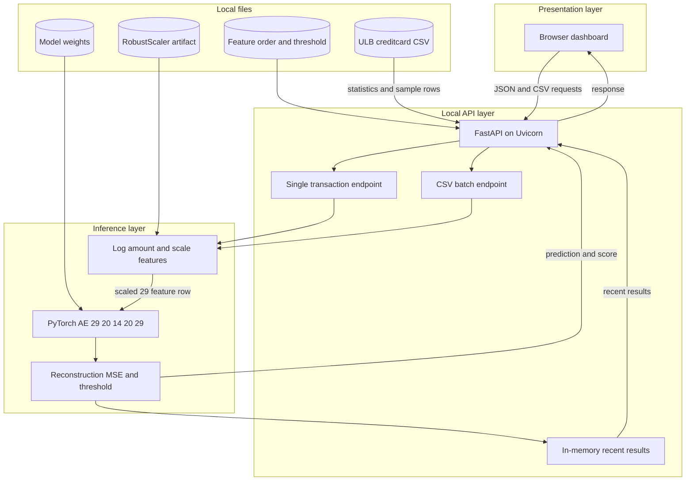
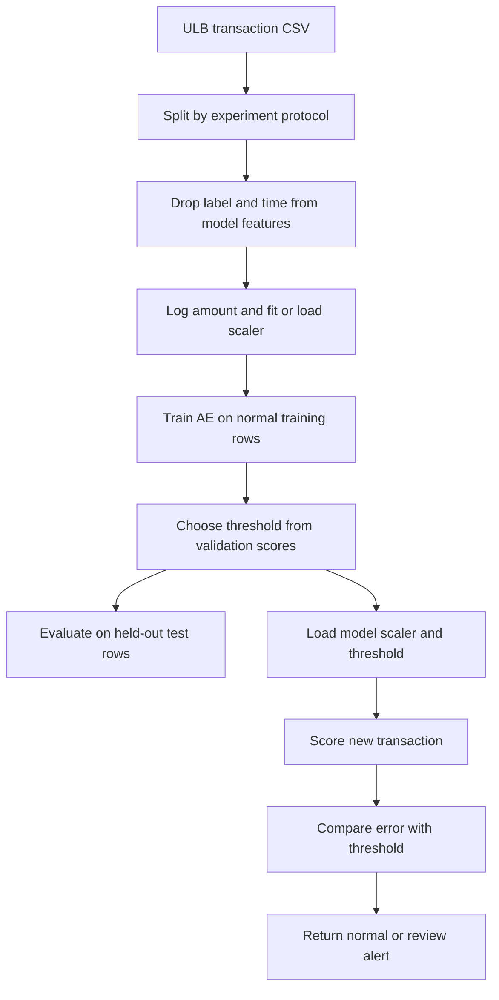
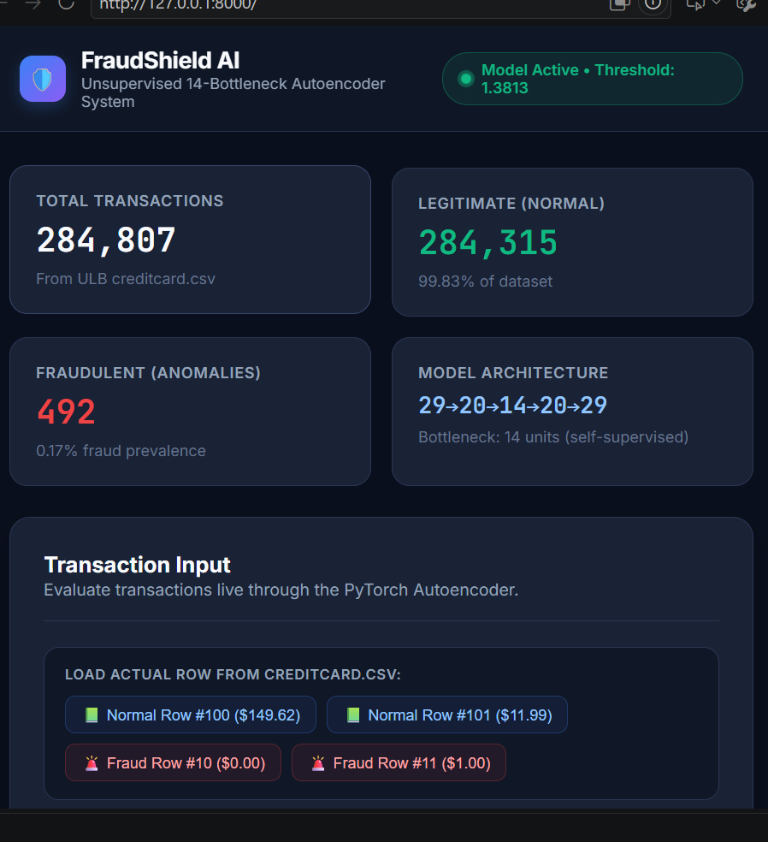
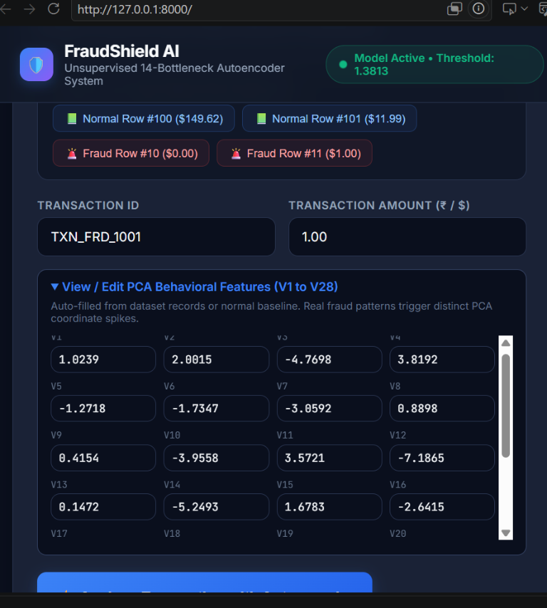
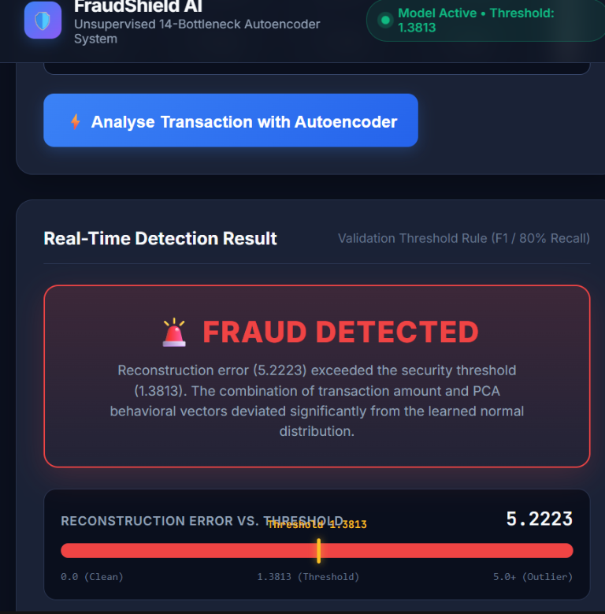

# Credit Card Fraud Detection Using an Unsupervised Autoencoder

## Academic Project Report

## 1. Title Page

**Submitted in partial fulfillment of the requirements for:** [Degree / Course Name]  
**Student name(s):** [Enter student name(s)]  
**Roll number(s):** [Enter roll number(s)]  
**Project guide:** [Enter guide name and designation]  
**Department:** [Enter department]  
**College / University:** [Enter institution name]  
**Academic year:** [Enter academic year]  
**Submission date:** [Enter date]

<div style="page-break-after: always;"></div>

## 2. Abstract

Credit card fraud detection is difficult because fraudulent transactions are rare, transaction patterns change over time, and labelled examples may be limited. This project investigates reconstruction-based anomaly detection using autoencoders on the public ULB credit-card transaction dataset. The dataset contains 284,807 rows, including 492 fraud-labelled transactions (0.1727%). The deployed dashboard model consumes 29 values: anonymized principal-component features V1-V28 and Amount. Amount is log-transformed, the row is scaled with a saved RobustScaler, and a PyTorch autoencoder reconstructs it. The mean squared reconstruction error is compared with a stored threshold of 1.3812579; scores at or above the threshold are flagged for review.

The repository contains two distinct experimental tracks and their results are reported separately. A chronological, single-run benchmark for bottleneck sizes 8, 14 and 20 reports PR-AUC 0.3519 for the 14-unit model, while a five-seed, stratified pipeline using a 5-unit bottleneck reports mean PR-AUC 0.470 +/- 0.101 for its normal-only autoencoder. These values are not interchangeable and the latter is not the deployed 14-unit model. The repository also includes Isolation Forest, One-Class SVM and Robust Deep Autoencoder comparisons, plus a supervised XGBoost benchmark in the chronological experiment.

The web application supports single-transaction scoring and CSV batch screening. A screenshot demonstrates an example score of 5.2223 against the stored threshold of 1.3813. This is a model score, not a probability. The report documents the implementation, experimental evidence, known inconsistencies and limitations; it does not claim that a flagged transaction is confirmed fraud.

**Keywords:** credit card fraud, anomaly detection, autoencoder, reconstruction error, imbalanced classification, RobustScaler

<div style="page-break-after: always;"></div>

## Table of Contents

1. [Title Page](#1-title-page)
2. [Abstract](#2-abstract)
3. [Introduction](#3-introduction)
4. [Problem Statement](#4-problem-statement)
5. [Objectives](#5-objectives)
6. [Literature Review](#6-literature-review)
7. [Existing System and Proposed System](#7-existing-system-and-proposed-system)
8. [Dataset Description](#8-dataset-description)
9. [System Architecture](#9-system-architecture)
10. [Methodology](#10-methodology)
11. [Autoencoder Architecture](#11-autoencoder-architecture)
12. [Implementation Details](#12-implementation-details)
13. [User Interface](#13-user-interface)
14. [Results and Discussion](#14-results-and-discussion)
15. [Testing](#15-testing)
16. [Advantages and Limitations](#16-advantages-and-limitations)
17. [Future Enhancements](#17-future-enhancements)
18. [Conclusion](#18-conclusion)
19. [References](#19-references)
20. [Information to Complete Before Submission](#information-to-complete-before-submission)

<div style="page-break-after: always;"></div>

## 3. Introduction

Electronic payments are convenient, but their scale and speed also create opportunities for unauthorized transactions. A fraud-screening system must identify suspicious transactions while avoiding excessive false alarms. This is especially challenging when the positive class is extremely rare: a classifier can appear accurate by predicting every transaction as legitimate, yet detect no fraud.

Anomaly detection offers a useful alternative when the objective is to identify observations that differ from learned normal patterns. An autoencoder is trained to compress an input and reconstruct it. If training examples represent normal behavior, a transaction that differs substantially from those patterns may have a larger reconstruction error. The score can then be compared with a decision threshold.

This repository implements a local credit-card fraud demonstration and several offline experiments. The live dashboard uses a 14-dimensional bottleneck autoencoder. The research pipeline also includes a separate five-seed comparison using a 5-dimensional bottleneck, Robust Deep Autoencoder (RDA) experiments, and traditional anomaly-detection baselines. Because the projects use different split strategies, model sizes and threshold rules, this report identifies each experiment explicitly rather than combining their results.

The ULB dataset's V1-V28 variables are anonymized principal-component features. They do not expose the original raw attributes used to create those components. The project therefore evaluates patterns in the supplied transformed features, not a complete real-world cardholder profile.

## 4. Problem Statement

Given a transaction represented by its amount and anonymized behavioral features, determine whether its pattern is sufficiently unlike the patterns learned from normal transactions to warrant review. The detector must account for the severe class imbalance and should not rely on fraud labels as reconstruction targets.

For a transaction feature vector \(x\), the autoencoder produces a reconstruction \(\hat{x}\). The project calculates a per-row mean squared reconstruction error:

\[
E(x) = \frac{1}{d}\sum_{j=1}^{d}(x_j-\hat{x}_j)^2,\quad d=29.
\]

For the deployed application, the classification rule is:

\[
\hat{y} =
\begin{cases}
\text{FRAUD / review}, & E(x) \geq 1.3812579,\\
\text{NORMAL}, & E(x) < 1.3812579.
\end{cases}
\]

The label “FRAUD” is a model alert, not a legal or financial confirmation that fraud occurred. The score is not a calibrated probability.

## 5. Objectives

The project objectives, as evidenced by the source code and artifacts, are:

1. Load and preprocess the ULB `creditcard.csv` dataset.
2. Train autoencoder-based anomaly detectors using normal transactions for the normal-only AE experiments.
3. Compare AE and RDA variants with Isolation Forest and One-Class SVM.
4. Use validation data to select a decision threshold and reserve test data for reporting in the offline pipelines.
5. Produce PR-AUC, ROC-AUC, precision, recall, F1-score and confusion-matrix outputs where the pipeline supports them.
6. Package a trained 14-bottleneck model behind a local FastAPI service.
7. Provide a browser dashboard for individual scoring and CSV batch screening.
8. Keep the results of different split and model configurations clearly distinguished.

## 6. Literature Review

### 6.1 Anomaly detection

Anomaly detection methods rely on assumptions about how unusual observations differ from ordinary observations. Chandola, Banerjee and Kumar survey major anomaly-detection approaches and emphasize that method effectiveness depends on whether its assumptions fit the data and application [1]. In this project, the central assumption is that a model trained on normal transactions will reconstruct them more reliably than atypical transactions.

### 6.2 Autoencoders and robust deep autoencoders

An autoencoder learns an encoder and decoder that map an input through a lower-dimensional representation and reconstruct it. Reconstruction error is a common anomaly score. Zhou and Paffenroth's Robust Deep Autoencoder work combines a deep autoencoder with a sparse component to separate a structured component from sparse corruption [2]. The repository implements an approximate alternating procedure inspired by this approach: it trains an autoencoder on the current low-rank estimate and applies a proximal shrinkage operation to the residual.

The repository explicitly departs from the paper's optimization: it uses mini-batch Adam and one shrinkage step per outer round, without the dual variable used in the paper's ADMM/Bregman-style formulation. Therefore the project RDA is a simplified implementation inspired by the method, not a reproduction of the original optimizer.

### 6.3 One-Class SVM and Isolation Forest

One-Class SVM estimates a region of feature space containing the normal training distribution [3]. Isolation Forest isolates observations using random partitions; anomalies are expected to require fewer partitions on average [4]. The repository uses these as unsupervised/one-class baselines trained on the normal training subset. Their raw library scores are negated where required so that a larger project score consistently means “more anomalous.”

### 6.4 Relationship between prior work and this implementation

The papers above establish the method families and algorithms. They do not report the results in this project. The reported numbers in this document come from the CSV artifacts in this repository. The web service's 14-unit checkpoint is also distinct from the five-seed, default-config AE experiment. Published performance claims must not be attributed to this implementation.

## 7. Existing System and Proposed System

### 7.1 Existing approaches represented in the repository

The project includes reference anomaly-detection baselines and an offline supervised benchmark. Isolation Forest and One-Class SVM are implemented in `src/baselines.py`. The `scripts/run_14_bottleneck_pipeline.py` script additionally evaluates XGBoost as a supervised comparison; it uses fraud labels and is not part of the unsupervised deployed detector.

### 7.2 Proposed project system

The dashboard's proposed system is a 14-bottleneck autoencoder served by FastAPI. It receives V1-V28 and Amount, applies the saved preprocessing artifact, computes reconstruction error, compares the error to the saved threshold and returns a label plus score. CSV batch scoring applies the same model and preprocessing contract to each row.

The “unsupervised” description needs a qualification. The AE loss does not consume fraud labels, but the normal-only training datasets are selected using `Class == 0`. Validation labels are used for threshold selection, and test labels are used for metric reporting. This is a normal-only training protocol with label-assisted sample selection, not an entirely label-free end-to-end workflow. RDA is trained on the unlabeled mixed training matrix in the default pipeline; `ae_all` is the corresponding contaminated-data control.

| Aspect | Existing/reference approach in the project | Proposed dashboard system |
|---|---|---|
| Scoring | IF, OCSVM and offline RDA/AE variants | 14-bottleneck AE reconstruction MSE |
| Decision | Threshold chosen on validation in experiments | Compare score with saved threshold 1.3812579 |
| User interface | Command-line scripts and saved plots/tables | Local HTML/CSS/JavaScript dashboard |
| Batch screening | Offline model pipelines | FastAPI CSV endpoint, up to 200 MiB and 300,000 rows |
| Output | Metrics and figures | Per-row result, recent history and flagged-row CSV download |
| Supervised comparator | XGBoost in one experiment only | Not used in live inference |

**Table 1.** Existing/reference approaches and the proposed dashboard system.

## 8. Dataset Description

The main dataset is the ULB credit-card fraud dataset distributed through Kaggle [5]. The inspected local file is `data/raw/creditcard.csv`.

| Property | Verified value |
|---|---:|
| Rows | 284,807 |
| Columns | 31 |
| Normal transactions (`Class = 0`) | 284,315 |
| Fraud-labelled transactions (`Class = 1`) | 492 |
| Fraud prevalence | 0.1727% |
| Normal-to-fraud ratio | approximately 578:1 |
| Missing values in the inspected CSV | 0 |
| `Amount` minimum / median / maximum | 0.00 / 22.00 / 25,691.16 |
| `Time` range | 0 to 172,792 seconds |

**Table 2.** Verified summary statistics for the inspected ULB CSV.

The 31 columns are `Time`, `V1` through `V28`, `Amount` and `Class`. `Class` is the evaluation label; 0 means normal and 1 means fraud. V1-V28 are anonymized PCA-transformed variables. `Time` is elapsed time in seconds from the first transaction. The model input drops `Time` and `Class`, leaving 29 model features: V1-V28 and Amount. Amount is log-transformed; the code performs no currency conversion. The dashboard's currency symbol is a display label and does not change the numeric input.

The source file's observed size is approximately 146.23 MiB. The current batch endpoint accepts up to 200 MiB and 300,000 rows; the full 284,807-row file is below both configured limits.

### 8.1 Split protocols present in the repository

There are two distinct split protocols. They must not be described as one experiment.

| Protocol | Train | Validation | Test | Use |
|---|---:|---:|---:|---|
| Chronological 60/20/20, seed 42 | 170,884 rows; 360 frauds | 56,961 rows; 57 frauds | 56,962 rows; 75 frauds | 14-bottleneck time-split benchmark |
| Stratified 60/20/20, seed 0 | 170,884 rows; 295 frauds | 56,961 rows; 98 frauds | 56,962 rows; 99 frauds | Five-seed `src` pipeline; displayed seed-0 split summary |

**Table 3.** Exact row and fraud counts for the two inspected split protocols.

The chronological split sorts by `Time` before assigning the first 60%, next 20% and final 20%. The default configuration instead uses stratified random splits for seeds 0-4. The different fraud counts reflect the different split protocols and must be considered when comparing results.

## 9. System Architecture

The live service is a local, file-backed application. It has no database, message broker, remote scoring service or persistent transaction-history store. The browser sends JSON or a CSV upload to FastAPI. The API uses the saved model, scaler and metadata; the dataset is also loaded at service startup for summary statistics and sample buttons.

<!-- mermaid-checked: no \n, no em-dash/en-dash, no {} in labels, subgraphs are id["label"], arrows are -->|"label"|, all subgraphs closed by end, ids unique -->


**Figure 1.** Application architecture: browser, local API, inference components and local artifacts.

### 9.1 Component responsibilities

| Component | Responsibility |
|---|---|
| Browser dashboard | Collects transaction input, displays model results and submits CSV files |
| FastAPI service | Serves the page and exposes statistics, sample, history, single-score and batch-score endpoints |
| Preprocessing | Applies log1p to Amount and transforms the 29 features with the saved RobustScaler |
| PyTorch autoencoder | Reconstructs scaled input features |
| Decision logic | Compares mean squared reconstruction error with the threshold |
| Local artifacts | Provide model weights, feature order, threshold and scaler parameters |
| Dataset file | Supplies summary counts and demonstration sample rows |

**Table 4.** Component inventory and responsibilities.

The API is configured to bind to `127.0.0.1:8000` by the launcher. CORS is permissive in the source, but the documented launcher binds to localhost. The application stores no persistent history database; recent backend history is held in memory and is limited to 50 entries.

## 10. Methodology

### 10.1 Data loading and preprocessing

For the main ULB pipeline, `src/data.py` verifies required columns, removes `Class` from the feature matrix and applies:

\[
A' = \log(1 + \max(A,0)).
\]

The configured ULB preprocessing drops `Time`. A `RobustScaler` is fitted on training-normal rows in `src.data.build_split`, then applied to training, validation and test rows. Robust scaling centers by the median and scales by the interquartile range, reducing sensitivity to extreme feature values.

The separate 14-bottleneck script also sorts by Time and applies log1p to Amount, but its scaler is fitted on the entire chronological training partition, including training fraud rows, before the autoencoder's training subset is filtered to normals. This differs from the normal-only scaler fit in `src/data.py`; the distinction is a reproducibility and protocol caveat.

### 10.2 Training and validation

For normal-only AE experiments, labels are used to select the normal rows in the training partition, but labels are not input to the reconstruction loss. The AE minimizes mean squared error between the scaled input and its reconstruction. A 10% holdout from the training-normal data is used for early stopping.

In the five-seed default pipeline, the AE uses encoder widths `[20, 10, 5]`, 60 maximum epochs, batch size 256, Adam learning rate 0.001 and patience 8. In the 14-bottleneck experiment, the custom script uses a 29-20-14 encoder, a 14-20-29 decoder, up to 100 epochs, batch size 256, learning rate 0.001 and patience 5. The plotted run contains 30 epochs.

The RDA experiment in `src/models_ae.py` begins with an unlabeled mixed training set. In each outer round it trains an AE on the current low-rank estimate and applies either elementwise L1 or rowwise L2,1 shrinkage to the residual. With `lam_quantile` configured, lambda is recalculated from a residual quantile each round. This implementation is an approximation, as described in Section 6.2.

### 10.3 Threshold selection and testing

Threshold selection is performed on validation scores, then applied to test scores. The general evaluation module supports:

- **F1 mode:** select the threshold maximizing validation F1.
- **Recall mode:** select the highest threshold that still meets the configured target recall, when a threshold meeting the target exists.

The default five-seed configuration selects the F1 threshold. The separate 14-bottleneck experiment uses a target recall of 0.80 and chooses the highest validation precision among the thresholds meeting that recall target. Test labels are used for reported metrics, not for selecting the threshold.

The deployed application reads a fixed threshold, 1.3812578916549683, from `outputs/saved_model/meta.json`. The repository does not contain a script that writes this saved checkpoint, scaler and metadata together, and the metadata does not record the threshold-selection method. The dashboard text says “F1 / 80% Recall,” but that text alone does not establish how the saved threshold was generated. The report therefore treats 1.3813 as the artifact's configured decision cutoff and reports benchmark metrics separately.

### 10.4 Workflow pseudocode

```text
for each transaction x:
    transform Amount with log1p
    scale [V1 ... V28, Amount] with saved RobustScaler
    x_hat = autoencoder(x)
    error = mean((x - x_hat) ** 2)
    if error >= saved_threshold:
        flag for review
    else:
        label normal
```

<!-- mermaid-checked: no \n, no em-dash/en-dash, no {} in labels, subgraphs are id["label"], arrows are -->|"label"|, all subgraphs closed by end, ids unique -->


**Figure 2.** Experiment and prediction workflow, from data preparation through the threshold decision.

## 11. Autoencoder Architecture

The deployed model is a fully connected, symmetric multilayer perceptron:

| Stage | Operation | Activation |
|---|---|---|
| Input | 29 scaled features | - |
| Encoder 1 | Linear 29 to 20 | ReLU |
| Bottleneck | Linear 20 to 14 | ReLU |
| Decoder 1 | Linear 14 to 20 | ReLU |
| Output | Linear 20 to 29 | Linear output |

**Table 5.** Deployed 14-bottleneck autoencoder layers.

Its compact notation is **29 -> 20 -> 14 -> 20 -> 29**. The first 28 input values are the transformed V1-V28 features and the remaining value is transformed Amount. The model artifact's tensor dimensions confirm this layer layout. The output layer has no activation function.

For a scaled feature row \(x\), the autoencoder produces \(\hat{x}=D(E(x))\). The inference score is:

\[
E(x)=\operatorname{mean}_{j=1,\ldots,29}\bigl((x_j-\hat{x}_j)^2\bigr).
\]

The backend flags the row when \(E(x)\geq 1.3812578917\). The error and threshold are on the scaled feature space; the error is neither a currency amount nor a probability. A score of 5.2223 is about 3.78 times the stored cutoff, which explains the red result banner shown in the screenshot.

## 12. Implementation Details

### 12.1 Software and dependencies

| Layer | Technology | Version evidence | Purpose |
|---|---|---|---|
| Language | Python | No Python version is pinned in the project manifest | Data processing, model training and API |
| Deep learning | PyTorch | `requirements.txt`: `torch>=2.2` | Autoencoder training and inference |
| Data handling | NumPy, pandas | `numpy>=1.26`, `pandas>=2.1` | Feature arrays and CSV processing |
| ML utilities | scikit-learn | `scikit-learn>=1.4` | RobustScaler, baselines and metrics |
| Backend | FastAPI, Uvicorn | `fastapi>=0.110`, `uvicorn>=0.27` | Local REST API |
| Frontend | HTML, CSS, vanilla JavaScript | No separate frontend build system | Browser dashboard |
| Serialization | joblib and PyTorch state dict | Artifact files in `outputs/saved_model` | Load saved scaler and weights |
| Tests | pytest | `pytest>=8.0` | Unit and pipeline checks |
| Configuration | YAML | `pyyaml>=6.0` | Experiment settings |

**Table 6.** Technology stack and declared dependency constraints.

The project does not include a lockfile. In the inspected `.venv`, Python is 3.12.2 and loading the saved scaler produced a scikit-learn version warning: the artifact identifies scikit-learn 1.8.0 while the environment reports 1.9.1. Batch scoring completed in the report-time check, but reproducing the exact training environment requires matching dependency versions.

### 12.2 Main source modules

| File | Role |
|---|---|
| `src/data.py` | ULB loading, feature transformation, splitting, scaling and saved split arrays |
| `src/models_ae.py` | AE and RDA models, training loops, shrinkage and scoring |
| `src/train.py` | Multi-seed AE, contaminated AE and RDA runners |
| `src/evaluate.py` | Threshold selection, metrics and plots |
| `src/baselines.py` / `src/run_baselines.py` | Isolation Forest and One-Class SVM |
| `src/report.py` | Aggregates scores into per-seed and mean/std result tables |
| `src/data_ieee.py` | Optional IEEE-CIS preprocessing pipeline |
| `backend_server.py` | FastAPI endpoints and use of saved 14-unit model artifacts |
| `dashboard.html` | Live browser UI, individual scoring, batch upload and display logic |
| `scripts/predict_transaction.py` | Command-line demonstration using the saved 14-unit artifact |
| `demo_app.html` | Separate illustrative prototype; it generates random demonstration errors and is not served by the FastAPI root route |

**Table 7.** Main implementation files inspected for this report.

### 12.3 API endpoints

| Method and path | Function |
|---|---|
| `GET /` | Serves `dashboard.html` |
| `GET /api/stats` | Returns dataset totals and threshold |
| `GET /api/samples` | Returns selected real rows for normal/fraud demonstration buttons |
| `GET /api/history` | Returns the in-memory backend history |
| `POST /api/predict` | Scores a single transaction |
| `POST /api/predict-sample` | Scores a selected real dataset row and also returns its dataset label |
| `POST /api/predict-batch` | Validates and scores a CSV, returning totals and flagged rows |

**Table 8.** FastAPI routes exposed by the local service.

For a single request, the backend fills omitted V1-V28 entries with the normal-class median values from the local dataset. Batch CSV files must contain numeric `Amount` and V1-V28 fields, finite values and non-negative Amount. A transaction ID is optional. `Class` is not required for batch scoring and is not used by the prediction calculation; if present, the original column is retained in flagged-row output.

The current batch endpoint permits 200 MiB and 300,000 rows. It transforms and scores in chunks of 8,192 rows, but it still reads the upload and parses the full CSV into memory before inference. It returns flagged rows for download and stores only recent items in backend history.

## 13. User Interface

### 13.1 Dashboard overview

The dashboard shows dataset totals, model architecture and the stored threshold. The dataset count cards describe labels in the source CSV; they are not counts of current predictions. Buttons load selected pre-labelled rows from the dataset. The model then predicts independently from the row values.



**Figure 3.** Dashboard overview. The counts (284,807 total, 284,315 normal and 492 fraud-labelled) come from the dataset.

### 13.2 Individual transaction form

The form accepts a transaction ID, amount and V1-V28 values. Sample buttons populate these fields from selected dataset rows and trigger scoring. The amount is transformed and used as a model feature; the UI does not convert currencies. When a request reaches the API, the result banner shows the prediction, reconstruction error, threshold and error-to-threshold ratio.



**Figure 4.** Individual transaction form. V1-V28 are anonymized PCA-derived inputs from the dataset, not human-readable card details.



**Figure 5.** Captured example: reconstruction error 5.2223 exceeds the threshold 1.3813, so the model flags the example for review. The screenshot is a demonstration, not an aggregate test result.

### 13.3 CSV batch screening

The batch panel accepts CSV files up to 200 MiB and 300,000 rows. It requires `Amount` and V1-V28; optional transaction IDs are retained. The screen reports processed, flagged and normal counts and allows downloading the flagged rows as a CSV. No successful batch-screening screenshot was present in the supplied application screenshots; a direct endpoint check is documented in Section 15.

### 13.4 Transaction history and fallback behavior

The backend keeps up to 50 recent results in memory. The browser adds individual results to the visible table during the current page session. No database or durable history store is implemented, so history should not be treated as persistent.

There is an important reliability caveat: if the single-transaction API request fails, `dashboard.html` calls `estimateOffline`. That function uses a simple hand-written feature-sum/amount rule and creates an estimated score; it is **not** an autoencoder prediction. The separate `demo_app.html` is also illustrative and uses random errors. Results from either fallback/demo must not be presented as real model inference. The backend-served live API path is the path that runs the PyTorch model.

## 14. Results and Discussion

The repository contains results from two different experiment protocols. Table 9 is the chronological bottleneck experiment. Table 10 is the default multi-seed stratified experiment. They use different bottlenecks, split strategies, training runs and threshold rules, so direct one-to-one ranking across the tables is not justified.

### 14.1 Chronological bottleneck experiment

`outputs/bottleneck_14_experiment/benchmark_table.csv` reports one chronological 60/20/20 experiment. Thresholds were selected on validation for an 80% recall target. The reported table does not include confusion counts or the numerical threshold for each model.

| Model | Uses fraud labels in training | PR-AUC (AP) | ROC-AUC | Precision | Recall | F1 |
|---|---:|---:|---:|---:|---:|---:|
| Autoencoder, bottleneck 14 | No | 0.3519 | 0.9475 | 0.1109 | 0.8267 | 0.1956 |
| Autoencoder, bottleneck 8 | No | 0.3547 | 0.9504 | 0.0888 | 0.7733 | 0.1593 |
| Autoencoder, bottleneck 20 | No | 0.5983 | 0.9351 | 0.1662 | 0.8133 | 0.2760 |
| Isolation Forest | No | 0.0319 | 0.9487 | 0.0229 | 0.7867 | 0.0445 |
| One-Class SVM | No | 0.0819 | 0.9409 | 0.0477 | 0.8133 | 0.0902 |
| XGBoost, supervised | Yes | 0.7951 | 0.9685 | 0.3131 | 0.8267 | 0.4542 |

**Table 9.** Single-run chronological benchmark, values copied from the repository result file. XGBoost is a supervised reference, not the deployed model. Among the three AE bottleneck settings, the 20-unit model has the largest recorded PR-AUC in this run; the 14-unit application model is not the top PR-AUC result in this table.

The time-split test set contains 75 frauds among 56,962 rows, so its random PR-AUC baseline is approximately 0.0013. The 14-unit AE's PR-AUC is substantially above that baseline, but its precision of 0.1109 means that many flagged cases in this operating point are false positives. The high recall reflects the validation target-recall thresholding approach. A threshold chosen to capture most frauds normally trades off precision.


**Figure 6.** 14-bottleneck training loss. The figure shows training and holdout MSE across the plotted run. The script allows up to 100 epochs with early stopping; this saved curve contains 30 epochs.


**Figure 7.** Chronological test PR curves for the three AE widths, unsupervised baselines and supervised XGBoost. The random floor is approximately 0.0013.


**Figure 8.** 14-bottleneck test score distribution. The distributions overlap; reconstruction error is informative but not a perfect separator.

### 14.2 Five-seed stratified comparison

`outputs/ulb/results_table.csv` aggregates five seeds (0-4) using the default stratified pipeline. This AE has a 5-unit bottleneck (`[20, 10, 5]`), not the deployed 14-unit bottleneck. The default threshold mode is validation F1. Values are mean +/- sample standard deviation over the five saved runs.

| Model | Seeds | PR-AUC (AP) | ROC-AUC | Precision | Recall | F1 |
|---|---:|---:|---:|---:|---:|---:|
| Isolation Forest | 5 | 0.166 +/- 0.032 | 0.951 +/- 0.018 | 0.261 +/- 0.048 | 0.244 +/- 0.100 | 0.243 +/- 0.058 |
| One-Class SVM | 5 | 0.163 +/- 0.036 | 0.942 +/- 0.021 | 0.192 +/- 0.054 | 0.442 +/- 0.174 | 0.261 +/- 0.075 |
| AE, normal-only training | 5 | 0.470 +/- 0.101 | 0.959 +/- 0.022 | 0.461 +/- 0.113 | 0.552 +/- 0.024 | 0.496 +/- 0.055 |
| AE, contaminated training | 5 | 0.106 +/- 0.038 | 0.935 +/- 0.019 | 0.166 +/- 0.066 | 0.242 +/- 0.111 | 0.181 +/- 0.069 |
| RDA, reconstruction score | 5 | 0.257 +/- 0.135 | 0.948 +/- 0.020 | 0.270 +/- 0.142 | 0.426 +/- 0.149 | 0.327 +/- 0.152 |
| RDA L1, reconstruction score | 5 | 0.216 +/- 0.100 | 0.951 +/- 0.023 | 0.248 +/- 0.095 | 0.418 +/- 0.176 | 0.307 +/- 0.125 |
| RDA L1, sparse score | 5 | 0.203 +/- 0.095 | 0.950 +/- 0.023 | 0.230 +/- 0.096 | 0.404 +/- 0.177 | 0.289 +/- 0.123 |

**Table 10.** Five-seed stratified results from `outputs/ulb/results_table.csv`. The best mean PR-AUC among these listed unsupervised results is AE normal-only training at 0.470; this is a 5-unit bottleneck result and should not be attributed to the 14-unit dashboard checkpoint.

The seed-0 test fraud prevalence and random-scorer PR-AUC are 0.001738. This illustrates why PR-AUC is useful: ROC-AUC can remain high when negatives greatly outnumber positives, while precision-recall behavior makes the positive-class trade-off more visible.


**Figure 9.** Seed-0 test PR curves for the available stratified comparison models. The plot is one seed, not the five-seed average.

### 14.3 Confusion matrix example

The following matrix is the actual seed-0 test confusion matrix for the **normal-only, 5-unit AE** in the stratified pipeline. Rows are true classes; columns are predicted classes.

|  | Predicted normal | Predicted fraud |
|---|---:|---:|
| True normal | TN = 56,761 | FP = 102 |
| True fraud | FN = 43 | TP = 56 |

**Table 11.** Seed-0 confusion matrix for the 5-unit AE, with the threshold selected on validation. It is not the confusion matrix for the deployed 14-unit artifact.

For this example, precision is \(56/(56+102)=0.3544\), recall is \(56/(56+43)=0.5657\), and F1 is 0.4358. The 99 frauds in this test split are few relative to 56,863 normal cases, which contributes to metric variability and sensitivity to a small number of classification changes.


**Figure 10.** Confusion matrix for the 5-unit AE on stratified seed 0.


**Figure 11.** Test score distributions by dataset label for the 5-unit AE. The overlap shows why a threshold is needed and why false positives and false negatives remain.

### 14.4 Metrics and interpretation

- **Precision** \(= TP/(TP+FP)\): among transactions flagged by the model, the fraction labelled fraud in the evaluation set.
- **Recall** \(= TP/(TP+FN)\): among fraud-labelled transactions, the fraction flagged.
- **F1-score** \(= 2PR/(P+R)\): harmonic mean of precision and recall.
- **PR-AUC in this repository:** `average_precision_score` (average precision) computed from ranked scores. It summarizes precision across recall levels and is sensitive to rare positive classes.
- **ROC-AUC:** probability-ranking summary across true-positive and false-positive rates; it may appear high under severe class imbalance even when precision is low.
- **Confusion matrix:** counts true negatives (TN), false positives (FP), false negatives (FN) and true positives (TP) at a particular threshold.

For fraud screening, false negatives can represent missed fraud, while false positives create manual review workload. The project reports these metrics but does not assign monetary costs or optimize an operational cost function.

### 14.5 Lambda sweep and application example

The saved seed-0 RDA lambda sweep reports its largest validation reconstruction PR-AUC at `lam_quantile = 0.995`: lambda 10.6394, sparse-row fraction 0.0050 and validation PR-AUC 0.3600. This is a validation result for the RDA experiment, not a test result or the deployed AE threshold.

The dashboard screenshot shows a selected transaction `TXN_FRD_1001` with amount 1.00. The model returned reconstruction error 5.2223 and the artifact threshold 1.3813, so it was flagged. This is one example prediction; it must not be interpreted as a population-level accuracy estimate.

## 15. Testing

### 15.1 Automated tests

The repository test suite was run during report preparation:

```text
10 passed in 19.82s
```

`tests/test_pipeline.py` primarily exercises the synthetic ULB pipeline: data splitting, leakage-related invariants, threshold selection, score metrics, AE/RDA behavior and IEEE-CIS preprocessing on a mock DataFrame. The test suite does not provide browser end-to-end tests, does not test the live FastAPI routes, and does not validate the IEEE-CIS pipeline on its real competition files.

### 15.2 Full-file batch functional check

The current batch endpoint was directly called with the local `data/raw/creditcard.csv` file. It processed all 284,807 rows and returned 1,485 flagged rows and 283,322 normal predictions. This verifies the endpoint's full-file processing path under the current 200 MiB / 300,000-row limits. It is a functional check, not an accuracy result: the batch response was not compared with `Class` labels to calculate performance, and no held-out claim is made from this check.

### 15.3 Manual UI evidence

The supplied dashboard screenshots show the dataset summary, input form and a reconstruction-error result. A successful batch-screening UI screenshot was not available. The screenshot showing an old “10 MB limit” error came from an older running backend and is not used as evidence of the current configured limit.

## 16. Advantages and Limitations

### 16.1 Advantages

- The normal-only autoencoder learns a compact representation without using fraud labels in its reconstruction objective.
- The score is a continuous reconstruction error, allowing a threshold to be adjusted for a recall or precision preference.
- The project includes multiple baselines, model variants, seeds and saved plots rather than relying on one metric.
- The dashboard provides a visible score, cutoff, example inputs and downloadable flagged rows.
- Batch inference is divided into chunks to avoid sending all rows through the model in one inference tensor.

### 16.2 Limitations and evidence gaps

1. **Not fully label-free:** `Class` labels are used to select normal-only training data and to select validation/test outcomes. The model loss is unsupervised, but data preparation is label-assisted.
2. **Different experiments:** the 14-unit model uses a chronological single-run benchmark, while the `src` default pipeline uses five stratified seeds and a 5-unit AE. Their scores must not be combined or presented as the same model.
3. **Scaler protocol differs:** the 14-unit benchmark script fits its scaler on the entire training partition; the default `src` pipeline fits on normal training rows only.
4. **Deployed artifact provenance:** model weights, scaler and threshold files exist, but no in-repository training/export script writes them together. The saved metadata contains a threshold and feature list but not a training run ID, split, seed or threshold-selection method.
5. **Threshold ambiguity:** the dashboard text says “F1 / 80% Recall,” while separate scripts implement different selection rules. Exact provenance of the saved 1.3812579 threshold is not recorded.
6. **Fallback can mislead:** the dashboard's offline fallback is a heuristic with generated scores; the separate `demo_app.html` uses random values. Neither is real autoencoder inference.
7. **No production validation:** there is no payment-gateway integration, database, durable audit log, authentication, drift monitor or cost-based alert policy. The web app is configured as a local demonstration.
8. **Limited feature context:** V1-V28 are anonymized PCA components. The system cannot explain a flagged decision in terms such as merchant, location or customer history.
9. **Currency handling:** no currency conversion is implemented. The amount must be in the same numeric units and preprocessing convention as the model's training data.
10. **Memory use:** the batch endpoint reads and parses the complete CSV in memory before chunked model inference. The byte and row caps reduce, but do not eliminate, host-memory requirements.
11. **IEEE-CIS is unevaluated:** preprocessing code and configuration exist, but the local IEEE-CIS raw files are absent and tests use mock data only. No IEEE-CIS performance result is available.
12. **Dependency reproducibility:** requirements are lower bounds rather than exact pins; a scikit-learn version mismatch warning was observed when loading the saved scaler in the inspected virtual environment.
13. **Documentation drift:** the README still states that no real results exist, whereas the workspace contains the ULB dataset, saved models, metrics and figures. The report uses the inspected artifacts as evidence and does not rely on that outdated status sentence.

## 17. Future Enhancements

1. Add a versioned training/export command that saves the model, scaler, feature order, threshold, split protocol, seed and dependency versions as one reproducible artifact.
2. Choose one documented evaluation protocol for the deployment model and rerun it across multiple seeds or chronological folds.
3. Generate and save the exact confusion matrix and threshold-specific metrics for the deployed 14-unit checkpoint.
4. Replace the simulated offline fallback with an explicit service-unavailable message so heuristic output cannot be mistaken for model output.
5. Load the threshold dynamically from the API in the dashboard and display its calibration protocol.
6. Add API tests for schema validation, boundary file sizes, row limits and batch outputs; add browser-level end-to-end tests.
7. Add cost-sensitive threshold selection, calibration analysis and an alert-review workflow.
8. Evaluate temporal drift and retraining schedules on later periods.
9. Evaluate the IEEE-CIS pipeline on its real data after obtaining the required competition files and accepted terms.
10. For production use, add authentication, request limits, persistent audit storage, monitoring, privacy controls and a deployment threat review.
11. Consider incremental CSV parsing or asynchronous batch jobs for larger uploads and constrained machines.

## 18. Conclusion

This project demonstrates reconstruction-based fraud screening with a PyTorch autoencoder and a local FastAPI dashboard. The deployed architecture compresses 29 scaled transaction features through a 14-unit bottleneck and flags rows whose mean squared reconstruction error meets or exceeds the stored cutoff of 1.3812579. The UI provides individual input, batch CSV screening and visual score interpretation.

The repository contains useful evaluation evidence, including a chronological 14-bottleneck benchmark and a separate five-seed stratified comparison. The normal-only 5-unit AE achieved the highest mean PR-AUC among the listed unsupervised models in the latter table, while the 14-unit chronological run achieved PR-AUC 0.3519 at the reported target-recall operating point. These are separate experiments. The results show promise relative to their random PR-AUC baselines, but precision, false-positive workload, split variability, artifact provenance and fallback behavior limit conclusions about production readiness.

The system should therefore be presented as an academic prototype and an anomaly-review aid, not as a definitive fraud adjudicator. Further work should make the deployed checkpoint reproducible, document its threshold calibration, test the actual API/UI routes and evaluate operational costs on a carefully controlled temporal test protocol.

## 19. References

1. V. Chandola, A. Banerjee and V. Kumar, “Anomaly Detection,” *ACM Computing Surveys*, vol. 41, no. 3, Article 15, 2009. doi: [10.1145/1541880.1541882](https://doi.org/10.1145/1541880.1541882).
2. C. Zhou and R. C. Paffenroth, “Anomaly Detection with Robust Deep Autoencoders,” in *Proceedings of the 23rd ACM SIGKDD International Conference on Knowledge Discovery and Data Mining*, 2017, pp. 665-674. doi: [10.1145/3097983.3098052](https://doi.org/10.1145/3097983.3098052).
3. B. Schölkopf, J. C. Platt, J. Shawe-Taylor, A. J. Smola and R. C. Williamson, “Estimating the Support of a High-Dimensional Distribution,” *Neural Computation*, vol. 13, no. 7, pp. 1443-1471, 2001. doi: [10.1162/089976601750264965](https://doi.org/10.1162/089976601750264965).
4. F. T. Liu, K. M. Ting and Z.-H. Zhou, “Isolation Forest,” in *2008 Eighth IEEE International Conference on Data Mining*, 2008, pp. 413-422. doi: [10.1109/ICDM.2008.17](https://doi.org/10.1109/ICDM.2008.17).
5. Machine Learning Group - ULB, “Credit Card Fraud Detection,” Kaggle dataset. Available: [https://www.kaggle.com/datasets/mlg-ulb/creditcardfraud](https://www.kaggle.com/datasets/mlg-ulb/creditcardfraud). Accessed 16 November 2026.
6. IEEE-CIS, “IEEE-CIS Fraud Detection,” Kaggle competition. Available: [https://www.kaggle.com/competitions/ieee-fraud-detection](https://www.kaggle.com/competitions/ieee-fraud-detection). The repository's implementation is not evaluated on the competition data.

## Information to Complete Before Submission

- Student name(s), roll number(s), degree/program and section.
- Department, college/university name, logo and required title-page format.
- Guide/supervisor name, designation and department.
- Academic year, submission date and any required certificate/declaration pages.
- Confirm whether the 14-bottleneck benchmark table should be attributed to the exact saved dashboard checkpoint. The current repository does not record that artifact linkage.
- If an exact evaluation of the deployed checkpoint is required, provide or generate its held-out predictions, threshold-selection record and confusion matrix. These are not available as a saved evaluation artifact.
- Confirm the institute's preferred citation style and whether IEEE-CIS should remain as an unevaluated future-work item.
